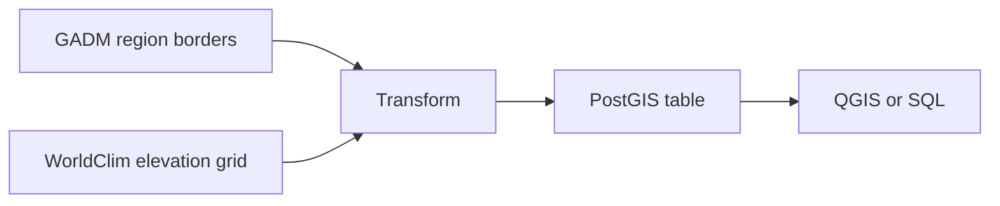

# GIS Full-Stack Roadmap

Learning in public: GIS development notes, notebooks and one small data pipeline.

## Spatial ETL: average elevation per region

Given a 3-letter country code, the pipeline downloads the country's first-level regions, measures elevation inside each one, and stores the result in PostGIS.

What the transform step does: removes empty shapes, repairs broken ones, matches the coordinate systems, computes zonal statistics, and flags regions with too few pixels as `reliable = False`.

### Run it

1. Download `wc2.1_5m_elev.zip` from the WorldClim 2.1 page, unzip it, and put `wc2.1_5m_elev.tif` in `sample-data/`.
2. Install: `conda install -c conda-forge geopandas rasterio rasterstats sqlalchemy psycopg2 geoalchemy2 pytest`
3. Run: `python spatial_etl/run.py PAK`
4. It asks for the PostgreSQL password. It is never stored in the code. Alternatively set the `PGPASSWORD` environment variable.
5. Test: `python -m pytest -q`

The load is repeatable: running a country twice replaces its rows instead of duplicating them, and a check confirms row counts and shape validity.

### Example result (Pakistan, from the loaded table)

| Region type in the data | Regions | Weighted mean height |
|---|---|---|
| CentrallyAdministeredArea | 2 | 3,872 m |
| Territory | 1 | 1,362 m |
| Province | 4 | 708 m |
| CapitalTerritory | 1 | 599 m |

Averages are weighted by pixel count, not a plain average of region averages.

### Known limits

- The elevation grid has pixels of about 9 km, so small regions (Islamabad has 11 pixels) are flagged unreliable, and peak heights are smoothed.
- Region types come from the GADM labels, which can be out of date.
- Data sources have their own terms of use. Check them before commercial use.

## Notebooks

Day-by-day practice: environment setup, GeoPandas, PostGIS, raster clipping and zonal statistics.

## Docker

`docker build -t region-api .` builds the API image. Run it with `docker run -p 8000:8000 -e PGPASSWORD=... -e PGHOST=<database host> region-api`. The CI workflow builds the image and checks `/health` and `/map/` on every push.
